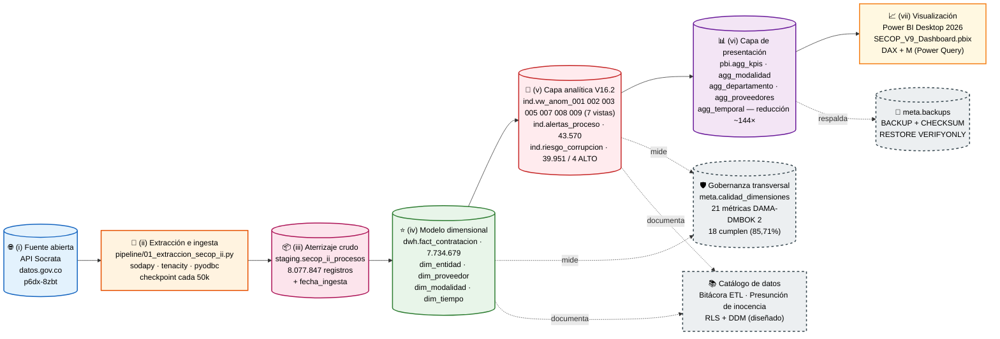

# Arquitectura de la solución

La solución se organiza en **siete capas funcionales** orquestadas sobre Microsoft SQL Server 2022 y Power BI Desktop, conforme al patrón dimensional Kimball y las áreas de Data Architecture, Data Storage & Operations y Data Warehousing & BI del marco DAMA-DMBOK 2. La **gobernanza** atraviesa transversalmente todas las capas, materializada en el schema `meta`.

## Diagrama de capas (siete capas + gobernanza transversal)



## Capas funcionales

| # | Capa | Responsabilidad | Tecnología | Schema/Carpeta |
|---:|---|---|---|---|
| i | Fuente abierta | Datos SECOP II vía API REST | Socrata (SODA 2.1) | `datos.gov.co/p6dx-8zbt` |
| ii | Extracción e ingesta | ETL incremental, paginado, con checkpoint | Python 3.10 + sodapy + tenacity + pyodbc | `pipeline/` |
| iii | Aterrizaje crudo | Conservación 1:1 de la fuente con linaje | SQL Server 2022 | `staging` |
| iv | Modelo dimensional | Esquema estrella Kimball, deduplicación, atribución | SQL Server 2022 | `dwh` |
| v | Capa analítica de indicadores | **7 vistas V16.2** declarativas (Share, persistencia deduplicada, z-score, percentiles) + materialización + **índice 0-17** | SQL Views + Tables | `ind` |
| vi | Capa de presentación | Pre-agregaciones para Power BI (reducción ~144×) | Tables denormalizadas | `pbi` |
| vii | Visualización | Dashboard interactivo, DAX + M | Power BI Desktop 2026 | `powerbi/` |
| ⟂ | **Gobernanza transversal** | Calidad DAMA-DMBOK, backups, catálogo, **seguridad operativa (RLS + DDM)** | Tables + procedimientos + roles + políticas | `meta`, `sec` |

## Flujo de datos end-to-end

1. **Python ETL** consulta el API SECOP II vía Socrata, descarga páginas de 50 k registros con throttling y reintentos exponenciales, registra cada lote en `staging.secop_ii_procesos` con `fecha_ingesta`.
2. **Script 03** carga las 4 dimensiones (entidad, proveedor, modalidad, tiempo) y la `fact_contratacion`, aplicando deduplicación por `ROW_NUMBER() OVER (PARTITION BY id_del_proceso ORDER BY fecha_ingesta DESC)` y filtros de existencia de FK.
3. **Script 04c V16.2** crea **7 vistas red flag estabilizadas tras calibración empírica iterativa** basadas en métricas relativas y estadísticas: `vw_anom_001_sobrecosto` (ratio > 1,5), `vw_anom_002_share_monetario` (Share ≥ 50 % por entidad-año), `vw_anom_003_unico_oferente` (modalidad competitiva), `vw_anom_005_persistencia` (3 años consecutivos, **deduplicada** a 1 alerta por par-año), `vw_anom_007_tiempo_atipico` (\|z-score log días\| ≥ 3), `vw_anom_008_ultracorto_alto` (días ≤ P10 + valor ≥ P90), `vw_anom_009_fragmentacion_umbral` (≥ 5 contratos en P95-P99 por modalidad), y `vw_alertas_todas`. Eliminados tras evidencia empírica: `vw_anom_004_hhi_entidad` (sobre-disparaba 89 % del universo) y `vw_anom_006_competencia_baja` (inviable por sub-reporte 99,15 % en `n_oferentes`).
4. **Script 05** materializa las alertas individuales en `ind.alertas_proceso` y calcula el índice compuesto **0-17 V16.2** en `ind.riesgo_corrupcion`, con clasificación SIN RIESGO / BAJO (1-3) / MEDIO (4-9) / ALTO (≥10). Resultado V16.2 sobre 7,73 M procesos: 43.570 alertas, 39.951 procesos con alerta, 4 en ALTO.
5. **Script 06** precalcula las 5 tablas `pbi.agg_*` para que Power BI responda en < 2 s sin escanear los 7,73 M procesos.
6. **Script 07** aplica las 21 métricas DAMA-DMBOK 2 sobre las 7 dimensiones de calidad y registra resultados en `meta.calidad_dimensiones`.
7. **Script 08** genera backup verificado (`BACKUP DATABASE` + `RESTORE VERIFYONLY`) y lo registra en `meta.backups`.
8. **Script 11** aplica los controles de seguridad: pobla `meta.clasificacion_sensibilidad` (22 columnas en 4 niveles), enmascara 5 columnas vía Dynamic Data Masking (`ALTER COLUMN ... ADD MASKED WITH FUNCTION = 'partial(...)'`), crea los roles operativos (`rol_auditor`, `rol_analista_publico`, `rol_ciudadano`) y activa la política Row-Level Security `sec.pol_riesgo_por_rol` sobre `ind.riesgo_corrupcion`. El script `11b_seguridad_pruebas.sql` valida el comportamiento por rol con tres usuarios de prueba.
9. **Power BI** consume las tablas `pbi.agg_*` con motor columnar VertiPaq y presenta 4 dashboards interactivos.

## Schemas y responsabilidades

```
SECOP_DWH/
├── staging                          ← API → aterrizaje
│   └── secop_ii_procesos
├── dwh                              ← modelo dimensional Kimball
│   ├── dim_entidad
│   ├── dim_proveedor
│   ├── dim_modalidad
│   ├── dim_tiempo
│   └── fact_contratacion
├── ind                              ← indicadores y alertas (V16.2)
│   ├── vw_anom_001_sobrecosto              (ratio > 1,5)                  peso 3
│   ├── vw_anom_002_share_monetario          (Share ≥ 50 % por entidad-año) peso 3
│   ├── vw_anom_003_unico_oferente           (modalidad competitiva)        peso 3
│   ├── vw_anom_005_persistencia             (3 años seguidos, deduplicada) peso 2
│   ├── vw_anom_007_tiempo_atipico           (|z-score log días| ≥ 3)       peso 2
│   ├── vw_anom_008_ultracorto_alto          (días ≤ P10 + valor ≥ P90)     peso 2
│   ├── vw_anom_009_fragmentacion_umbral     (≥ 5 contratos en P95-P99 mod) peso 2
│   ├── vw_alertas_todas (UNION ALL de 7 vistas)
│   ├── alertas_proceso (43.570 alertas)
│   └── riesgo_corrupcion (índice 0-17; 39.951 procesos, 4 ALTO)
├── pbi                              ← precálculos para Power BI
│   ├── agg_kpis
│   ├── agg_por_modalidad
│   ├── agg_por_departamento
│   ├── agg_top_proveedores
│   └── agg_temporal
├── meta                             ← gobernanza transversal
│   ├── calidad_dimensiones (DAMA-DMBOK 2 — 21 métricas)
│   ├── backups (bitácora de respaldos verificados)
│   ├── clasificacion_sensibilidad (22 columnas en 4 niveles)
│   └── audit_seguridad (eventos DDM/RLS)
└── sec                              ← seguridad operativa
    ├── fn_filtro_riesgo (predicado RLS por rol)
    └── pol_riesgo_por_rol (SECURITY POLICY sobre ind.riesgo_corrupcion)
```

## Cifras del último backup verificado

| Métrica | Valor |
|---|---:|
| Tamaño base de datos | 27,83 GB |
| Tamaño .bak comprimido | 5,26 GB |
| Ratio compresión | 5,30 × |
| Tiempo de backup | 67 segundos |
| Throughput | 417 MB/s |
| Páginas procesadas | 3.562.502 |
| Verificación `RESTORE VERIFYONLY` | OK |
| Archivo | `SECOP_DWH_V8_FINAL_<timestamp>.bak` |

## Marco metodológico

Combina dos referentes complementarios:

- **CRISP-DM** (Chapman et al., 2000) — guía el ciclo analítico de cada fase.
- **DAMA-DMBOK 2** (DAMA International, 2017) — gobierna calidad, metadatos, seguridad, linaje y operación. El proyecto aplica las 7 dimensiones canónicas de Data Quality (capítulo 13) y cubre 9 de las 11 áreas de conocimiento del marco.

El proyecto suscribe los principios de la **Open Contracting Data Standard (OCDS)** y se alinea con la literatura internacional sobre detección de anomalías en contratación pública (Fazekas y Tóth, 2016; Ferwerda y Delea